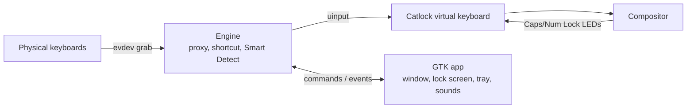

# Catlock

A keyboard lock for cat people, for Linux. One shortcut blocks every key so a cat can walk, sit or
sleep on the keyboard without typing anything. Smart Detect can lock it on its own the moment a paw
lands. It works the same on GNOME, KDE and other Wayland or X11 desktops.

> [!WARNING]
> Catlock has been entirely vibe coded: written by an AI assistant from a feature list, with
> limited human review. It can contain bugs and edge cases nobody has handled yet. It grabs every
> keyboard on the system, so keep the unlock shortcut in mind and try it on a machine where a stuck
> keyboard is a nuisance rather than a disaster. If Catlock misbehaves, quitting it (or killing the
> process) always returns the keyboards to normal.

Inspired by [Cats Lock](https://catslock.app/), the macOS app by Todd Alexander. Catlock is an
independent Linux reimplementation of its ideas; it shares no code with it and is not affiliated
with it.

## Features

| Feature | Notes |
|---|---|
| One shortcut, any app | `Ctrl+Alt+L` by default, recordable in Lock Settings. It must include Ctrl, Alt or Super, and only the exact chord counts, so a cat lying on those keys plus others does not unlock |
| Smart Detect | Locks on paw landings (neighbouring keys pressed together), resting paws, long single-key holds and zoomies. Five sensitivity levels, optional "ignore single key holds", and a live heat map of what the detector sees |
| "That wasn't my cat" | Shown on lock screens Smart Detect raised. Unlocks and relaxes only the rule that fired; the learned leniency is visible and resettable |
| Lock modes | Lock screen (overlay and sound), Stealth (no overlay, no sound, notification with Unlock), Built-in keyboard (only the laptop keyboard, released when the external keyboard is unplugged) |
| Touchpad lock | Optionally lock the laptop touchpad and pointing stick too, and free them again from the notification |
| Keep awake | Optionally inhibit screen blanking, session lock and suspend while locked, for long builds and renders |
| Lock screen | Backgrounds (Tabby, Prism, Sage, Midnight, Cream, Dimmed, your own photo) with adjustable opacity (below 100% it covers only the monitor in use, since GNOME draws nothing behind fullscreen windows), an icon or any emoji, a custom message, and a flash on every blocked key. One window per monitor |
| Deterrent sounds | Spoken warning, alarm, meow, dog bark, vacuum cleaner, bubbles, purr, lo-fi, or silence. Import your own clip (up to 15 s and 5 MB) |
| Profiles | Each profile has its own mode, sound and lock screen. Start any profile from the tray |
| Tray icon | Click to lock or unlock; menu for profiles, Smart Detect and settings |
| Safe by design | Unlocks automatically when the screen locks, the screensaver starts or the machine sleeps. If Catlock exits or crashes, the kernel releases the keyboards immediately |
| CLI | `catlock --lock [profile]`, `--unlock`, `--toggle`, `--status`, `--quit` control the running instance; bind them to anything |
| Privacy | Runs entirely locally. Keystrokes are counted for Smart Detect and never stored or sent |

## How it works

Catlock grabs every physical keyboard through evdev and re-emits its events through one virtual
keyboard (uinput). Locking simply stops forwarding, which needs no compositor support and lets
Catlock release held keys cleanly, so a paw on a key never leaves it auto-repeating in the focused
app. The shortcut is matched inside the same proxy, so no app can intercept it.



Stack: Rust, GTK 4 with libadwaita, tokio for the input engine, rodio for audio, ksni for the
StatusNotifierItem tray.

## Requirements

- Linux with `/dev/uinput`, GTK 4.18+ and libadwaita 1.9+.
- Your user in the `input` group, so Catlock can read keyboards without root:

  ```sh
  sudo usermod -aG input "$USER"   # then log out and back in
  ```

- For the tray icon on GNOME, the
  [AppIndicator extension](https://extensions.gnome.org/extension/615/appindicator-support/) must be
  active. Without a tray host, use the window, the CLI or a custom shortcut for `catlock --toggle`.

## Build and install

```sh
make test       # unit tests (detector, layout, config)
make install    # release build into ~/.local (binary, desktop entry, icons)
```

Run `catlock` once to start it and open the settings, or enable *Launch at login* under General.
Settings live in `~/.config/catlock/config.toml`; imported sounds in `~/.local/share/catlock/sounds`.

## Development

- `cargo run` runs from the source tree; icons are picked up from `data/icons`.
- Debug builds can render every page to PNG in a headless compositor:

  ```sh
  dbus-run-session -- sh -c 'mutter --headless --wayland --no-x11 --virtual-monitor 1100x760 \
      --wayland-display catlock-shot & sleep 3; WAYLAND_DISPLAY=catlock-shot \
      CATLOCK_SNAPSHOT=/tmp/shots cargo run'
  ```

- The built-in sounds are synthesized by `tools/gen_sounds.py` (stdlib only, plus `espeak-ng` for
  the spoken warning): `uv run --no-project python tools/gen_sounds.py`.

## License

Catlock is free software, licensed under the GNU General Public License v3.0 or later. See
[LICENSE](LICENSE).
